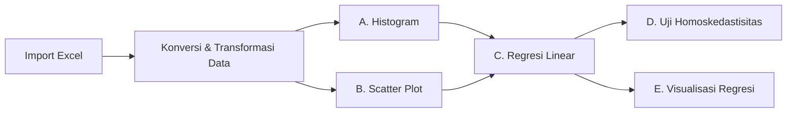

# Tugas 2 — Analisis dan Visualisasi Data

**Nama:** Reza Hartono<br>
**NIM:** 053126003<br>
**Prodi:** FST — Sistem Informasi

Regresi linear sederhana untuk melihat pengaruh **pendapatan** terhadap **kebahagiaan**, menggunakan R (`tugas.r`) dan data `data-tugas.xlsx`.

---

## Penjelasan Kode (`tugas.r`)

### 1. Install & Load Package

```r
if (!require("openxlsx")) install.packages("openxlsx")
if (!require("ggplot2")) install.packages("ggplot2")
...
```

- `require()` mengecek apakah package sudah terpasang.
- Jika belum (`!`), `install.packages()` akan memasangnya otomatis.
- `library()` memuat package ke sesi R agar fungsinya bisa dipakai.

| Package | Kegunaan |
|---|---|
| `openxlsx` | Membaca file Excel (`.xlsx`) |
| `ggplot2` | Membuat grafik |
| `dplyr` | Manipulasi data |
| `broom` | Merapikan output model regresi |
| `ggpubr` | Scatter plot + garis regresi siap pakai |

### 2. Import Data

```r
data <- read.xlsx("data-tugas.xlsx", sheet = 1, startRow = 2)
```

- `sheet = 1` → mengambil sheet pertama.
- `startRow = 2` → data dibaca mulai baris ke-2 (baris 1 dianggap judul).
- Hasilnya disimpan dalam dataframe bernama `data`.

### 3. Konversi Tipe Data

```r
data$pendapatan  <- as.numeric(data$pendapatan)
data$kebahagiaan <- as.numeric(data$kebahagiaan)
```

Memastikan kedua kolom bertipe **numerik** (bukan teks), karena regresi hanya bisa dihitung pada angka. Data dari Excel kadang terbaca sebagai karakter.

### 4. Transformasi Skala Pendapatan

```r
data$pendapatan <- data$pendapatan * 10000
```

Nilai pendapatan dikalikan 10.000 agar sesuai satuan aslinya (misalnya `5` menjadi `50.000`). Ini hanya mengubah **skala**, bukan pola data — koefisien regresi menjadi lebih mudah dibaca.

### 5. Menampilkan Data

```r
print(data)
```

Menampilkan seluruh isi dataframe untuk verifikasi awal.

### 6. (A) Histogram Distribusi Kebahagiaan

```r
ggplot(data, aes(x = kebahagiaan)) +
  geom_histogram(aes(y = after_stat(density)), bins = 20, ...) +
  geom_density(...) +
  ...
```

- `aes(x = kebahagiaan)` → variabel terikat pada sumbu X.
- `geom_histogram()` → histogram dengan 20 bin.
- `y = after_stat(density)` → sumbu Y diubah menjadi **kepadatan (density)**, bukan frekuensi, supaya bisa ditumpuk dengan kurva density.
- `geom_density()` → kurva estimasi distribusi (garis biru).
- **Tujuan:** mengecek bentuk distribusi variabel terikat (normal/tidak, simetris/miring).

### 7. (B) Scatter Plot Pendapatan vs Kebahagiaan

```r
ggplot(data, aes(x = pendapatan, y = kebahagiaan)) +
  geom_point(...) +
  ...
```

- `geom_point()` → titik untuk setiap observasi.
- `alpha = 0.7` → transparansi titik agar titik yang menumpuk tetap terlihat.
- **Tujuan:** melihat arah dan kekuatan hubungan linear antara variabel bebas dan terikat.

### 8. (C) Regresi Linear Sederhana

```r
model_regresi <- lm(kebahagiaan ~ pendapatan, data = data)
summary(model_regresi)
```

- `lm()` = *linear model*; rumus `y ~ x` berarti kebahagiaan diprediksi oleh pendapatan.
- Model disimpan di `model_regresi`.
- `summary()` menampilkan:
  - **Estimate** → nilai intercept dan slope.
  - **Std. Error, t value, Pr(>|t|)** → signifikansi tiap koefisien (p-value < 0,05 = signifikan).
  - **Multiple R-squared** → proporsi variasi kebahagiaan yang dijelaskan pendapatan.
  - **F-statistic** → uji kelayakan model secara keseluruhan.

### 9. (D) Uji Asumsi Homoskedastisitas

```r
par(mfrow = c(1, 1))
plot(model_regresi, which = 1)
```

- `par(mfrow = c(1, 1))` → mengatur layout grafik menjadi 1 baris × 1 kolom.
- `which = 1` → plot **Residuals vs Fitted**.
- **Cara baca:** titik-titik harus tersebar acak di sekitar garis 0 tanpa pola (corong/curve). Jika membentuk pola tertentu → asumsi homoskedastisitas **dilanggar** (terjadi heteroskedastisitas).

### 10. (E) Visualisasi Regresi dengan `ggpubr`

```r
ggscatter(data, x = "pendapatan", y = "kebahagiaan",
          add = "reg.line", conf.int = TRUE, ...) +
  stat_regline_equation(...) +
  ...
```

- `add = "reg.line"` → menambahkan garis regresi otomatis.
- `conf.int = TRUE` → menampilkan pita **confidence interval** (area keyakinan garis regresi).
- `add.params` → mengatur warna dan ketebalan garis regresi.
- `stat_regline_equation()` → menampilkan persamaan regresi pada grafik (`label.x`/`label.y` mengatur posisinya).
- `theme_bw()` + `theme()` → mempercantik tampilan; `hjust = 0.5` membuat judul rata tengah.

---

## Alur Analisis



## Cara Menjalankan

1. Pastikan file `data-tugas.xlsx` berada di folder yang sama dengan `tugas.r`.
2. Buka `tugas.r` di RStudio.
3. Jalankan dengan `source("tugas.r")` atau **Ctrl + Shift + Enter**.
4. Package yang belum ada akan terpasang otomatis pada saat pertama kali dijalankan.
